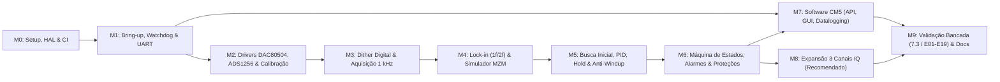

# Roadmap de Desenvolvimento de Firmware — Projeto 3 (BIAS MZM/IQ)

> **Repositório Alvo:** `Virtus-Projeto-HW-FW/Projeto-3` (`Projeto 3 - FW`)
> **Referência de Hardware (Somente Leitura):** `../Projeto 3 - HW/Projeto3-CM5-RP2040-MZM` (Revisão R6)
> **Divisão da Equipe:**
> - **Responsável A (`CM5`):** Linux no Raspberry Pi CM5, daemon de supervisão/heartbeat (`GPIO4`/`GPIO17`), protocolo UART mestre, API local/remota, GUI/Dashboard, persistência de calibração, datalogging e periféricos do CM5 (`J103`/`J104`).
> - **Responsável B (`MCU`):** Tempo real no RP2040 (`U300`), boot seguro e watchdog (`GP4`/`GP5`/`GP6`), drivers SPI0 (`DAC80504` e `ADS1256`), síntese digital de dither, demodulação síncrona lock-in ($1f/2f$), simulador MZM, varredura inicial, controlador PI/PID e máquina de estados.

---

## 1. Visão Geral dos Milestones, Caminho Crítico e Paralelismo

Como a PCB Revisão R6 encontra-se com projeto concluído mas pendente de montagem/bring-up físico, **todas as tasks possuem alternativa de execução e validação em Simulação/Mock** (via HAL desacoplada e simulador matemático da função de transferência $\cos^2$ do MZM). As tasks que exigem ou validam o hardware físico montado estão sinalizadas com **`[HW-FÍSICO / MOCK DISPONÍVEL]`**.

- **Caminho Crítico (Tempo Real / Controle):**
  `M0` $\rightarrow$ `M1` (`T04`, `T05`) $\rightarrow$ `M2` (`T07`, `T08`) $\rightarrow$ `M3` (`T10`, `T11`) $\rightarrow$ `M4` (`T13`, `T14`) $\rightarrow$ `M5` (`T16`, `T17`, `T18`) $\rightarrow$ `M6` (`T19`, `T20`) $\rightarrow$ `M9` (`T28`, `T29`, `T30`).
- **Trilhas Paralelas (Execução Simultânea A $\parallel$ B):**
  - Enquanto **B** desenvolve os drivers SPI0 (`M2`), o dither (`M3`), o lock-in (`M4`) e o controlador PID (`M5`) no RP2040, **A** desenvolve em paralelo o cliente UART, a persistência de calibração, o backend/API, o datalogger e a GUI no CM5 (`T06`, `T09`, `T12`, `T15`, `T21`, `T22`, `T23`, `T24`), usando o emulador de quadros UART no host/CM5.
  - O milestone `M8` (Expansão para 3 canais IQ — Escopo Recomendado) pode avançar em paralelo com a finalização da GUI em `M7` assim que a malha de 1 canal estiver fechada em `M6`.

---

## 2. Detalhamento dos Milestones e Tasks

### Milestone M0 — Setup, Toolchain, Arquitetura HAL e CI
- **Objetivo:** Estruturar o repositório de firmware (`firmware-rp2040/`, `software-cm5/`, `common/`, `tests/`), configurar o sistema de build (CMake + Pico SDK para RP2040; Python `pyproject.toml`/`venv` + `pytest` para CM5) e o pipeline de Integração Contínua (GitHub Actions) para compilação cruzada e testes unitários em host.
- **Definição de Pronto (DoD):** Repositório compila binário `.uf2` do RP2040 e pacote Python do CM5 automaticamente no GitHub Actions, com cabeçalho compartilhado de constantes de hardware (`pinout_r6.h` / `protocol_regs.h`) revisado contra `Conectividade_pinos_R6.csv`.

| ID | Task | Req. Relacionados | Esforço | Dep. | Resp. | Hardware / Alternativa Mock |
| :---: | :--- | :--- | :---: | :---: | :---: | :--- |
| **T01** | Estruturar árvore de diretórios do repositório, CMake + Pico SDK para RP2040 e ambiente Python/pytest para CM5, incluindo pipeline CI (GitHub Actions). | RNF-006 | P | — | A/B | 100% em software (compilação cruzada e runner Ubuntu no CI). |
| **T02** | Criar arquivos de definição de pinout Revisão R6 (`pinout_r6.h` e `hw_constants.py`) e contratos de interface da HAL (`hal_spi`, `hal_gpio`, `hal_uart`, `hal_time`) permitindo injeção de mocks para testes unitários no PC. | RF-001, RNF-005, RNF-006 | P | T01 | B | 100% em software (mocks em memória para registradores SPI/GPIO). |
| **T03** | Especificar e implementar biblioteca comum do protocolo de comunicação CM5 $\leftrightarrow$ RP2040 (framing binário `0xAA 0x55`, CRC-16/CCITT, serialização de registradores e parser CLI ASCII) com testes unitários em C e Python. | RF-102, RNF-006 | M | T01 | A | 100% em software (validado via portas seriais virtuais / buffers em memória). |

---

### Milestone M1 — Bring-up, Segurança de Inicialização, Watchdog e Link UART
- **Objetivo:** Garantir o estado seguro de inicialização (`MCU_ARM = 0`, relés desenergizados), a geração dos *heartbeats* de 10 Hz nos dois processadores (`GP5` e `GPIO4`) para manter o watchdog `CD74HCT123` (`U1000`) ativo, e estabelecer a comunicação bidirecional UART a 115200 bps entre CM5 e RP2040.
- **Definição de Pronto (DoD):** Boot seguro verificado (relés abertos no power-up), `WD_MCU` e `WD_CM5` operacionais com queda em $\le 450\text{ ms}$ ao parar qualquer *heartbeat*, e troca de pacotes `PING`/`SYS_STATUS` sem erros de CRC por 10 minutos a 115200 bps.

| ID | Task | Req. Relacionados | Esforço | Dep. | Resp. | Hardware / Alternativa Mock |
| :---: | :--- | :--- | :---: | :---: | :---: | :--- |
| **T04** | Implementar inicialização segura dos GPIOs do RP2040 (`MCU_ARM=0` em `GP4`, CS altos, leitura de `FAULT_N` em `GP6` e `ARM_REQUEST` em `GP7`), gerador de `MCU_HEARTBEAT` a 10 Hz (`GP5`) e watchdog interno de 200 ms. | RF-001, RF-002, RNF-003, RNF-004 | M | T02 | B | **`[HW-FÍSICO / MOCK DISPONÍVEL]`** Pode ser validado em um Raspberry Pi Pico avulso ou via testes unitários da HAL antes da PCB R6. |
| **T05** | Implementar servidor UART0 no RP2040 (`GP0/GP1`, 115200 8N1 com DMA/FIFO) no Core 1, processando leitura/escrita do mapa de registradores, timeout de comunicação de 300 ms e comando seguro de entrada em bootloader USB (`CMD_ENTER_BOOTLOADER`). | RF-102, RNF-003, RNF-007 | M | T03, T04 | B | **`[HW-FÍSICO / MOCK DISPONÍVEL]`** Testável via USB-UART no Pico avulso ou mock serial no host. |
| **T06** | Implementar daemon Linux no CM5 (`systemd` service) para geração de `CM5_HEARTBEAT` a 10 Hz (`GPIO4`), controle de `CM5_ARM_REQ` (`GPIO17`) e cliente UART (`/dev/ttyAMA0`) com reconexão automática e emulador de RP2040 via PTY para desenvolvimento sem placa. | RF-101, RF-102, RNF-003, RNF-004 | M | T03 | A | **`[HW-FÍSICO / MOCK DISPONÍVEL]`** Inclui modo `--mock-pty` que roda no PC/CM5 sem necessitar da PCB montada. |

---

### Milestone M2 — Drivers de Periféricos (DAC80504, ADS1256, Calibração e I2C/Fan)
- **Objetivo:** Desenvolver e testar unitariamente os drivers de acesso ao barramento `SPI0` compartilhado no RP2040 para o DAC de 16 bits (`U600`) e o ADC de 24 bits (`U400`), o módulo de conversão/calibração elétrica/óptica e os drivers de periféricos auxiliares do CM5 (`J103` I2C e `J104` Fan).
- **Definição de Pronto (DoD):** Drivers do `DAC80504` e `ADS1256` validados com testes unitários (100% das sequências SPI, `STATUS=0x06` com `BUFEN=1`, `PGA=1` e clamp em $\pm 7,50\text{ V}$ e $2,60\text{ V}$) e prontos para os ensaios E07, E09 e E10.

| ID | Task | Req. Relacionados | Esforço | Dep. | Resp. | Hardware / Alternativa Mock |
| :---: | :--- | :--- | :---: | :---: | :---: | :--- |
| **T07** | Implementar driver SPI0 para o `DAC80504RTER` (`U600`, `CS=GP20`, `LDAC=GP21`) com inicialização em *mid-scale* (`32768` $\Rightarrow 0\text{ V}$), atualização síncrona dos 4 canais, conversão $V_{\text{BIAS}} \leftrightarrow \text{código DAC}$ (compensando $R_L$ e $220\ \Omega$) e *clamping* rígido em $\pm 7,50\text{ V}$. | RF-001, RF-003, RF-005, RNF-005 | M | T02, T04 | B | **`[HW-FÍSICO / MOCK DISPONÍVEL]`** Validado por testes unitários que inspecionam os quadros de 24 bits SPI e limites matemáticos. |
| **T08** | Implementar driver SPI0 para o `ADS1256IDB` (`U400`, `CS=GP17`, `DRDY=GP22`, `RESET=GP2`, `SYNC=GP3`) com árbitro de barramento SPI0, configuração obrigatória `STATUS=0x06` (`BUFEN=1, ACAL=1`), `ADCON=0x00` (`PGA=1`), `SELFOCAL`, leitura contínua de `AIN0` a 1000 SPS e leitura sob demanda de `AIN1..AIN3` (`MON_I/Q/PHI`) a 60 SPS. | RF-004, RF-005, RNF-001, RNF-005 | G | T02, T07 | B | **`[HW-FÍSICO / MOCK DISPONÍVEL]`** Inclui mock de `ADS1256` que injeta amostras sintéticas de 24 bits a cada 1 ms. |
| **T09** | Implementar no CM5 o gerenciador de perfis de calibração (`VDARK`, ganhos de DAC/ADC, $R_L$, responsividade $\mathcal{R}$), supervisão térmica/PWM do cooler (`J104`) e driver opcional tolerante a ausência para display OLED I2C em `J103` (`GPIO2/3`). | RF-005, RF-105, RF-106, RNF-008 | M | T06 | A | **`[HW-FÍSICO / MOCK DISPONÍVEL]`** Barramento I2C e `/sys/class/thermal` abstraídos com fallback em caso de ausência do hardware. |

---

### Milestone M3 — Geração Digital de Dither e Aquisição Sincronizada (1000 Hz)
- **Objetivo:** Implementar no Core 0 do RP2040 o laço determinístico de $1000\text{ Hz}$ que sintetiza o sinal senoidal de dither (ex.: $17\text{ Hz}$, $20\text{ mV}$ pico), soma-o digitalmente ao nível DC de BIAS no `DAC80504` e captura de forma estritamente síncrona a amostra de `PHOTO_ADC` (`AIN0`) no `ADS1256`.
- **Definição de Pronto (DoD):** Laço de $1000\text{ Hz}$ executando com *jitter* $< 50\ \mu\text{s}$, gerando senoide limpa sem *clipping* nos limites de segurança e mantendo coerência de fase constante entre a referência do NCO e a leitura de `AIN0`.

| ID | Task | Req. Relacionados | Esforço | Dep. | Resp. | Hardware / Alternativa Mock |
| :---: | :--- | :--- | :---: | :---: | :---: | :--- |
| **T10** | Implementar oscilador controlado numericamente (NCO / LUT trigonométrica de 32 bits de acumulador de fase) no RP2040 para geração de dither senoidal com frequência ($5\text{ Hz}$ a $100\text{ Hz}$), amplitude ($0$ a $250\text{ mV}$) e fase configuráveis, somado ao BIAS DC com verificação preventiva de saturação ($|\text{DC}| + A_{\text{dither}} \le V_{\text{lim}}$). | RF-006, RNF-001, RNF-005 | M | T07 | B | 100% verificável em software e osciloscópio (`TP700` no Ensaio E08 quando a PCB estiver disponível). |
| **T11** | Implementar escalonador determinístico de $1000\text{ Hz}$ no Core 0 do RP2040 sincronizado à interrupção `ADC_DRDY_N` (`GP22`), coordenando no mesmo ciclo de $1\text{ ms}$: leitura de `AIN0` (`ADS1256`) $\rightarrow$ atualização do passo de dither no `DAC80504` sem colisão no `SPI0`. | RF-003, RF-004, RF-006, RNF-001 | M | T08, T10 | B | **`[HW-FÍSICO / MOCK DISPONÍVEL]`** Possui timer interno de 1 ms como fallback automático quando `ADC_DRDY_N` físico não estiver presente (modo simulador). |
| **T12** | Adicionar ao protocolo UART e ao cliente Python do CM5 o suporte a comandos de configuração de dither (`DITHER_EN`, `DITHER_FREQ_HZ`, `DITHER_AMP_V`, `DITHER_PHASE_DEG`) e captura de buffers de diagnóstico de alta taxa (osciloscópio virtual de `AIN0` e `DAC_CODE`). | RF-006, RF-102 | P | T05, T06, T10 | A | 100% testável via link UART ou emulador PTY. |

---

### Milestone M4 — Demodulação Síncrona Lock-In ($1f$ e $2f$) e Simulador do MZM
- **Objetivo:** Implementar a cadeia de processamento digital de sinais (DSP) de demodulação síncrona em fase e quadratura no fundamental ($1f$) e no 2º harmônico ($2f$), juntamente com o simulador matemático da função de transferência $\cos^2$ do MZM para validação fechada antes e durante os testes de bancada.
- **Definição de Pronto (DoD):** Demodulador extrai $E_{1f}$, $E_{2f}$ e $P_{\text{DC}}$ com rejeição de ruído fora de banda $\ge 40\text{ dB}$; conectado ao simulador interno do MZM, levanta a curva teórica completa de $P_{\text{DC}}$, $E_{1f}$ (proporcional a $-\sin(\pi V/V_\pi)$) e $E_{2f}$ (proporcional a $-\cos(\pi V/V_\pi)$).

| ID | Task | Req. Relacionados | Esforço | Dep. | Resp. | Hardware / Alternativa Mock |
| :---: | :--- | :--- | :---: | :---: | :---: | :--- |
| **T13** | Implementar o Simulador Interno de Função de Transferência do MZM (`mzm_sim.c` / `mzm_sim.py`), modelando $P_{\text{out}}(t)$ para 1 canal MZM e 3 canais IQ com parâmetros configuráveis ($V_\pi$, potência de entrada, razão de extinção, deriva térmica lenta $V_{\text{drift}}(t)$, ruído branco, ganho do TIA de $220\text{ k}\Omega$, pedestal `VDARK` de $0,2478\text{ V}$ e atraso de fase do Sallen-Key de $232\text{ Hz}$). | RF-013, RNF-006 | M | T02 | B | **100% em software** — desbloqueia a validação completa de `M4`, `M5`, `M6`, `M7` e `M8` sem depender da montagem da PCB ou do MZM óptico real. |
| **T14** | Implementar no RP2040 o demodulador lock-in digital de canal único ($1f$ e $2f$, componentes $I$ e $Q$ com compensação de fase $\phi_{\text{comp}} \approx -5,77^\circ$ a $17\text{ Hz}$) e filtros passa-baixas digitais (média síncrona sobre múltiplos inteiros do período de dither + IIR de 2ª ordem) para fornecer $E_{1f}$, $E_{2f}$ e $P_{\text{DC}}$. | RF-007, RNF-001 | G | T11, T13 | B | Validado diretamente contra `T13` (simulador MZM) e testes unitários com sinais ruidosos sintéticos. |
| **T15** | Criar suite de validação e visualização em Python no CM5 (`tools/lockin_validator.py`) que injeta rampas de BIAS no simulador/RP2040 e plota simultaneamente $P_{\text{DC}}$, $E_{1f}$ e $E_{2f}$ para certificar o cruzamento por zero e a relação de sinal nos pontos de Mínimo, Máximo, $Q^+$ e $Q^-$. | RF-007, RF-013, RNF-006 | P | T12, T13, T14 | A | 100% executável em software (CI / host) e reutilizável no Ensaio E13 de bancada. |

---

### Milestone M5 — Busca Inicial (Sweep), Controlador PI/PID, Hold e Anti-Windup
- **Objetivo:** Implementar a inteligência de controle de malha fechada: varredura inicial para mapear o MZM, seleção automática do ponto de operação (Mínimo, Máximo, $Q^+$, $Q^-$, Específico), transição suave (*bumpless*) e controlador digital PI/PID com *anti-windup*, *slew-rate limit* e *hold* por perda óptica.
- **Definição de Pronto (DoD):** Sistema localiza automaticamente qualquer um dos 4 pontos clássicos de operação a partir de uma condição inicial arbitrária em $\le 10\text{ s}$, fecha a malha mantendo erro residual de BIAS $< 1\%\text{ de }V_\pi$ sob deriva térmica sintética e entra em `HOLD` em $\le 50\text{ ms}$ ao cortar a luz.

| ID | Task | Req. Relacionados | Esforço | Dep. | Resp. | Hardware / Alternativa Mock |
| :---: | :--- | :--- | :---: | :---: | :---: | :--- |
| **T16** | Implementar algoritmo de varredura inicial (*Coarse Sweep*) no RP2040: varre $V_{\text{BIAS}} \in [V_{\text{min}}, V_{\text{max}}]$, registra $P_{\text{DC}}(V)$, estima $V_\pi$, identifica tensões de `MIN_NULL`, `MAX_PEAK`, `QUAD_POS` e `QUAD_NEG`, posiciona o DAC no ponto solicitado e realiza transição suave para rastreamento. | RF-008, RF-011 | M | T14 | B | Validado com o simulador MZM (`T13`) em todas as fases iniciais $\phi_0 \in [0, 2\pi]$. |
| **T17** | Implementar controlador digital PI/PID discreto no RP2040 para todos os pontos de operação (usando $E_{1f}$ assinado pelo sinal de $E_{2f}$ para Mínimo/Máximo, e erro normalizado para Quadratura/Alvo Específico), com ganhos $K_p, K_i, K_d$ configuráveis, limitador de *slew-rate*, *clamping* em $[V_{\text{min}}, V_{\text{max}}]$ e *anti-windup* condicional. | RF-009, RF-011, RNF-005 | G | T14, T16 | B | Validado em malha fechada contra degraus de deriva térmica no simulador MZM (`T13`). |
| **T18** | Implementar detector de perda de potência óptica (`OPTICAL_LOS` quando $I_{\text{PD}} < I_{\text{PD,min}}$) e lógica de congelamento instantâneo do integrador (`HOLD`), bem como estratégia de recuperação automática (retomada direta ou re-sweep configurável) quando a potência óptica retorna. | RF-010, RNF-005 | M | T17 | B | Validado simulando queda abrupta de $P_{\text{in}} \rightarrow 0$ no simulador MZM (`T13`). |

---

### Milestone M6 — Máquina de Estados, Alarmes, Latching de Falhas (`FAULT_N`) e Proteções
- **Objetivo:** Consolidar toda a lógica de segurança em uma máquina de estados determinística no RP2040 e no supervisor do CM5, integrando a interrupção de hardware `FAULT_N` (`GP6`), o diagnóstico pós-falha via `MON_I/Q/PHI` (`AIN1..3`) e as proteções contra sobretensão no ADC ($> 2,60\text{ V}$) e queda de comunicação.
- **Definição de Pronto (DoD):** Qualquer violação de janela (`FAULT_N=0`), sobretensão no ADC, perda de UART ($> 300\text{ ms}$) ou queda de `ARM_REQUEST` desarma `MCU_ARM` (`GP4=0`), zera os DACs e trava em `FAULT_LATCHED`, exigindo `CMD_CLEAR_FAULT` explícito após normalização.

| ID | Task | Req. Relacionados | Esforço | Dep. | Resp. | Hardware / Alternativa Mock |
| :---: | :--- | :--- | :---: | :---: | :---: | :--- |
| **T19** | Implementar a Máquina de Estados completa no RP2040 (`INIT`, `IDLE_SAFE`, `PRE_ARM_CHECK`, `ARMED_MANUAL`, `SWEEPING`, `TRACKING`, `HOLD`, `FAULT_LATCHED`, `MAINTENANCE_CAL`) com matriz estrita de transições permitidas e cobertura de 100% em testes unitários. | RF-012, RNF-003, RNF-006 | M | T04, T16, T17, T18 | B | 100% verificável por testes unitários em host e simulação HIL. |
| **T20** | Implementar ISR de alta prioridade para `FAULT_N` (`GP6`, borda de descida $\rightarrow$ `MCU_ARM=0` em $< 100\ \mu\text{s}$ e DACs em *mid-scale*) e rotina automática de autodiagnóstico pós-falha que lê `AIN1..AIN3` (`MON_I/Q/PHI`) a 60 SPS para identificar qual canal ou barramento (`±11VA`) causou o desarme. | RF-001, RF-004, RF-012, RNF-002, RNF-005 | M | T08, T19 | B | **`[HW-FÍSICO / MOCK DISPONÍVEL]`** ISR e diagnóstico testáveis injetando pulso baixo em `GP6` ou via mock da HAL. |
| **T21** | Implementar gerenciador de alarmes e eventos críticos no CM5: recepção de quadros assíncronos `ASYNC_ALARM`, revogação imediata de `CM5_ARM_REQ` (`GPIO17=0`) em caso de falha grave e registro de auditoria (*fault log*) com estado congelado pré-falha. | RF-101, RF-102, RF-104, RNF-002, RNF-003 | M | T06, T19, T20 | A | Validado injetando falhas simuladas pelo RP2040 / emulador UART. |

---

### Milestone M7 — Software do CM5 (API REST/WebSocket, GUI/Dashboard e Datalogging)
- **Objetivo:** Entregar a pilha completa de software no Raspberry Pi CM5 para operação local ou remota, incluindo API REST/WebSocket, painel gráfico interativo em tempo real e serviço de registro contínuo de dados (*datalogging*) na eMMC.
- **Definição de Pronto (DoD):** Operador consegue controlar todos os modos (Manual/Auto, Mín/Máx/Quad), configurar ganhos PID e dither, comandar busca inicial, visualizar gráficos temporais de BIAS, erros $1f/2f$ e potência óptica a $\ge 10\text{ Hz}$ e baixar os logs CSV da sessão.

| ID | Task | Req. Relacionados | Esforço | Dep. | Resp. | Hardware / Alternativa Mock |
| :---: | :--- | :--- | :---: | :---: | :---: | :--- |
| **T22** | Implementar backend de supervisão no CM5 (Python FastAPI + WebSockets) expondo endpoints REST para todos os comandos/registradores do RP2040 e stream WebSocket de telemetria em tempo real a 20 Hz. | RF-102, RF-103, RF-105 | M | T06, T12, T21 | A | 100% funcional usando o RP2040 em modo simulador ou o emulador PTY. |
| **T23** | Desenvolver Interface Gráfica / Web Dashboard responsiva (acessível localmente no CM5 ou via navegador na rede) com controles de Arme/Desarme, seleção de Modo e Ponto de Operação (1 ou 3 canais), ajuste de constantes PID/Dither/Limites, visualização da curva de varredura (*Sweep*) e gráficos em tempo real. | RF-103, RF-011 | G | T22 | A | 100% validável contra o backend conectado ao simulador MZM. |
| **T24** | Implementar motor de *Datalogging* contínuo no CM5 (gravação assíncrona em CSV/SQLite na eMMC com rotação automática de arquivos, *timestamp* de alta resolução e botão de exportação na GUI) registrando $V_{\text{BIAS}}$, $V_{\text{MON}}$, $E_{1f}$, $E_{2f}$, $I_{\text{PD}}$, $P_{\text{opt}}$ e alarmes. | RF-104, RNF-008 | M | T22 | A | Validado em teste de estresse de gravação contínua por $> 1\text{ h}$ em software. |

---

### Milestone M8 — Expansão para 3 Canais IQ Simultâneos ($I$, $Q$ e $\Phi$ — Escopo Recomendado)
- **Objetivo:** Expandir a geração de dither, a demodulação lock-in e as malhas de controle do RP2040 e da GUI do CM5 para operar simultaneamente nos 3 canais da placa R6 (`Bias_I`, `Bias_Q` e `Bias_PHI`), utilizando frequências de dither ortogonais ($f_I = 17\text{ Hz}$, $f_Q = 23\text{ Hz}$, $f_\Phi = 29\text{ Hz}$).
- **Definição de Pronto (DoD):** Três malhas fechadas simultâneas operando a 1000 Hz no Core 0 do RP2040 com folga de CPU ($\le 60\%$ de ocupação do Core 0), rejeição de *crosstalk* inter-canais $\ge 40\text{ dB}$ e estabilização simultânea de $I$, $Q$ e $\Phi$ no simulador IQ e na bancada.

| ID | Task | Req. Relacionados | Esforço | Dep. | Resp. | Hardware / Alternativa Mock |
| :---: | :--- | :--- | :---: | :---: | :---: | :--- |
| **T25** | Expandir o NCO de dither e a escrita síncrona no `DAC80504` (`OUT0=I`, `OUT1=Q`, `OUT2=PHI`, acionados simultaneamente via `DAC_LDAC_N`) para gerar 3 senoides independentes ($17\text{ Hz}, 23\text{ Hz}, 29\text{ Hz}$) a 1000 Hz. | RF-014, RNF-001 | M | T11, T19 | B | Validado em simulação e nos pontos de teste `TP700`, `TP800` e `TP900`. |
| **T26** | Expandir o banco de demoduladores lock-in ($1f/2f$) e controladores PI/PID para 3 canais paralelos com janelas de integração ortogonais (ex.: janela de $1,0\text{ s}$ que contém exatamente $17$, $23$ e $29$ ciclos inteiros) e busca inicial coordenada ($I \rightarrow Q \rightarrow \Phi$). | RF-014, RF-007, RF-008, RF-009 | G | T17, T25 | B | Validado contra o modelo de modulador IQ de 3 portas no simulador (`T13`). |
| **T27** | Atualizar API, GUI e Datalogger no CM5 para visualização, configuração independente e operação coordenada dos 3 canais ($I$, $Q$, $\Phi$), incluindo presets de modulação IQ (ex.: QPSK/16-QAM com $I$ e $Q$ em *Null* e $\Phi$ em *Quadratura*). | RF-014, RF-103, RF-104 | M | T23, T24, T26 | A | Validado de ponta a ponta com o simulador IQ de 3 canais. |

---

### Milestone M9 — Testes de Validação em Bancada (Seção 7.3 / E01–E19) e Documentação Final
- **Objetivo:** Executar o Plano Mínimo de Testes da Seção 7.3 do PDF e o roteiro de Ensaios de Bancada E01 a E19 da placa Revisão R6 (com validação prévia integral via HIL/Simulador e execução na PCB assim que montada), consolidando a documentação técnica final para entrega acadêmica.
- **Definição de Pronto (DoD):** Todos os 5 testes obrigatórios da Seção 7.3 e os critérios da Seção 10 aprovados e documentados com gráficos, logs CSV e relatório de aceitação em `docs/`.

| ID | Task | Req. Relacionados | Esforço | Dep. | Resp. | Hardware / Alternativa Mock |
| :---: | :--- | :--- | :---: | :---: | :---: | :--- |
| **T28** | Automatizar e executar os Testes 1, 2 e 3 da Seção 7.3 (Geração de BIAS/dither, Busca e estabilização em Mín/Máx/Quadratura e Ensaio de estabilidade temporal de longa duração com perturbação térmica — Ensaios E07, E08, E13, E14, E18), gerando relatórios e gráficos a partir dos logs. | RF-003 a RF-009, RF-104, RNF-001, RNF-008 | G | T20, T24, T26 | A/B | **`[HW-FÍSICO / MOCK DISPONÍVEL]`** Script automatizado roda primeiro contra o simulador HIL e depois na bancada física. |
| **T29** | Executar e documentar os Testes 4 e 5 da Seção 7.3 (Teste completo da Interface/GUI/Logs e Teste de Proteções: perda de luz `HOLD`, sobretensão de janela `FAULT_N`, queda de `HEARTBEAT` e perda de UART — Ensaios E05, E06, E11, E12). | RF-001, RF-002, RF-010, RF-012, RF-101, RF-103, RNF-002 a RNF-005 | M | T21, T23, T28 | A/B | **`[HW-FÍSICO / MOCK DISPONÍVEL]`** Ensaios de falha validados via injeção de falhas no simulador e em bancada. |
| **T30** | Consolidar a documentação final de entrega em `docs/` (Manual de Arquitetura e Operação, Mapa de Registradores definitivo, Guia de Bring-up/Calibração e Relatório de Resultados dos Testes da Seção 7.3 e Seção 10). | RNF-006, RNF-007 | M | T27, T28, T29 | A/B | 100% documentação técnica no repositório. |
