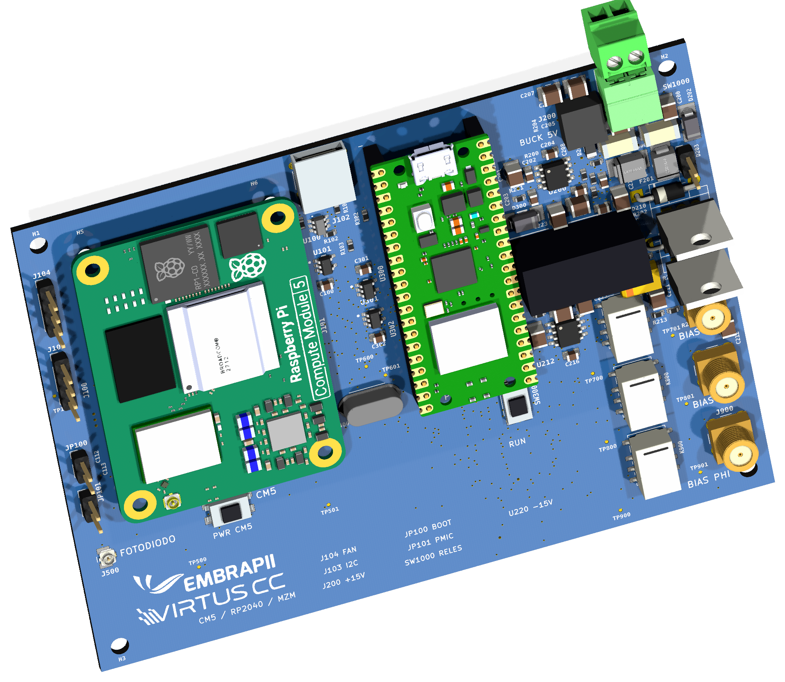

# Controlador de polarização MZM com CM5 e RP2040

**Projeto 3 · Versão V1.1 · UFCG — Departamento de Engenharia Elétrica**

Placa-base com Raspberry Pi Compute Module 5 (CM5) e Raspberry Pi Pico (RP2040) para aquisição do sinal de um fotodiodo, supervisão e geração de três tensões de polarização (**I, Q e PHI**) destinadas a um modulador Mach–Zehnder (MZM).

A placa tem contorno retangular de **120 × 90 mm**, montagem nas duas faces e quatro camadas de cobre.

## Documentação técnica

| Documento | PDF | Editável |
| --- | --- | --- |
| Relatório principal | [Ler](docs/relatorios/PDF/Relatorio_CM5_RP2040_MZM.pdf) | [DOCX](docs/relatorios/Word/Relatorio_CM5_RP2040_MZM.docx) |
| Conexões e imagens 3D | [Ler](docs/relatorios/PDF/Relatorio_Conexoes_3D.pdf) | [DOCX](docs/relatorios/Word/Relatorio_Conexoes_3D.docx) |
| Pinagem e interfaces | [Ler](docs/relatorios/PDF/Relatorio_Pinagem_CM5_RP2040_MZM.pdf) | [DOCX](docs/relatorios/Word/Relatorio_Pinagem_CM5_RP2040_MZM.docx) |
| Ensaios de bancada | [Ler](docs/relatorios/PDF/Ensaios_de_Bancada_CM5_Photonic_Bias.pdf) | [DOCX](docs/relatorios/Word/Ensaios_de_Bancada_CM5_Photonic_Bias.docx) |
| Simulações LTspice | [Ler](docs/relatorios/PDF/Relatorio_LTspice_CM5_RP2040_MZM.pdf) | [DOCX](docs/relatorios/Word/Relatorio_LTspice_CM5_RP2040_MZM.docx) |
| Apresentação | [Ler](docs/relatorios/Apresentacao_Projeto3_CM5_RP2040_MZM.pdf) | [PPTX](docs/relatorios/Apresentacao_Projeto3_CM5_RP2040_MZM.pptx) |

[Desenho técnico da placa (PDF)](docs/relatorios/PDF/DWF.pdf)

## Arquivos da placa

- **Projeto Altium:** [`hardware/altium/CM5_RP2040_MZM.PrjPcb`](hardware/altium/CM5_RP2040_MZM.PrjPcb)
- **Layout da PCB:** [`hardware/altium/CM5_RP2040_MZM.PcbDoc`](hardware/altium/CM5_RP2040_MZM.PcbDoc)
- **Biblioteca:** [`hardware/altium/CM5_Projeto_R6.PcbLib`](hardware/altium/CM5_Projeto_R6.PcbLib)
- **Esquemáticos e BOM:** [hardware/altium](hardware/altium)
- **Modelos STEP incorporados ao Altium:** [hardware/altium/ALTIUM_EMBEDDED_MODELS](hardware/altium/ALTIUM_EMBEDDED_MODELS)
- **Simulações LTspice:** [simulacoes](simulacoes)
- **Vídeo youtube:** https://youtu.be/A3gGHM6tSEQ

## Autores

Carlos Renan Correia Fidelis · Carlos Elias Fialho de Lima · Pablo Daniel Nascimento Vieira

Universidade Federal de Campina Grande · Engenharia Elétrica · 2026.
